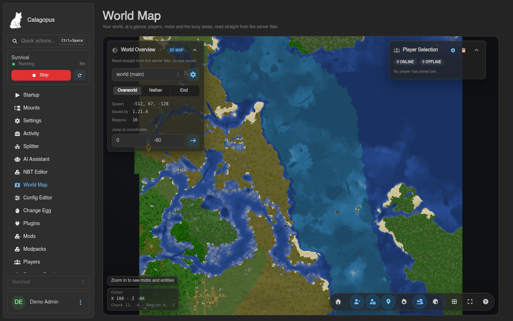
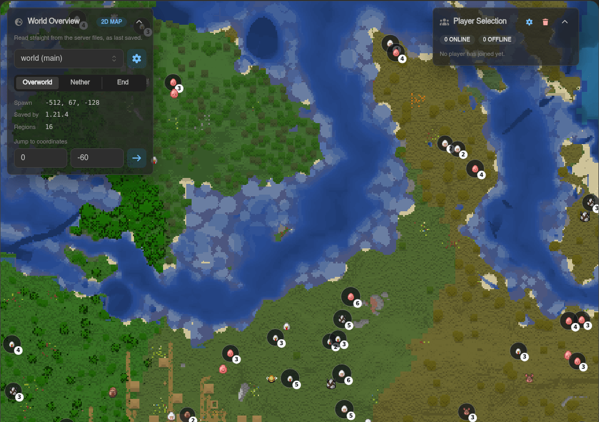
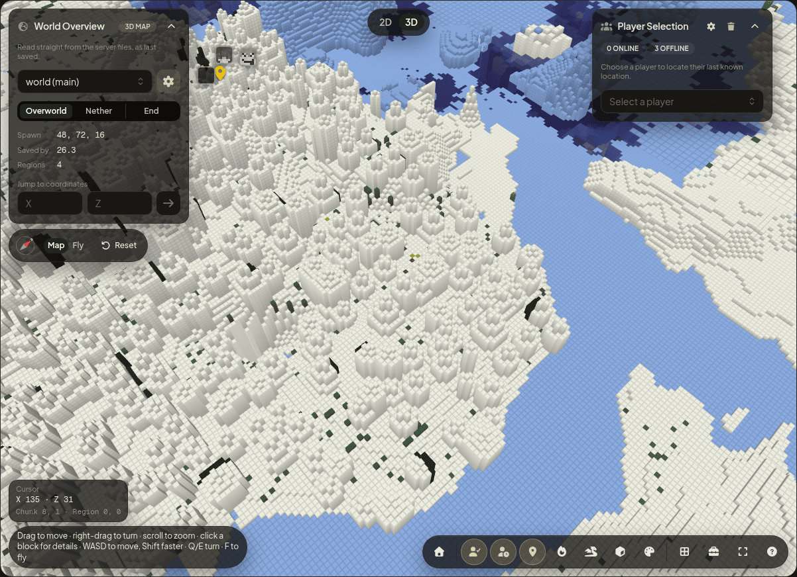
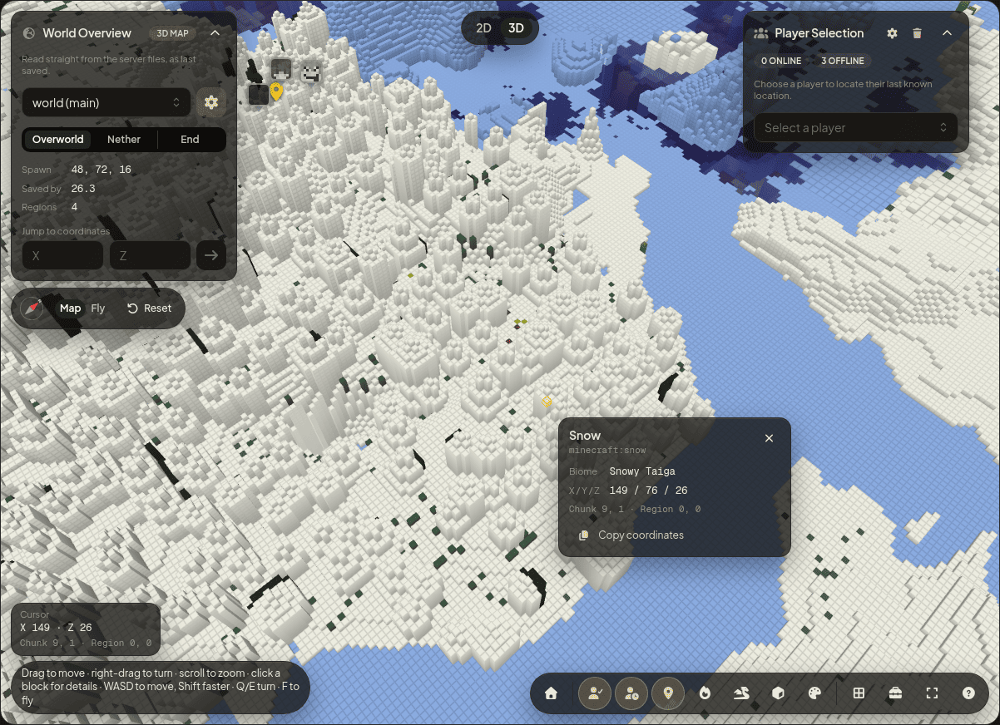
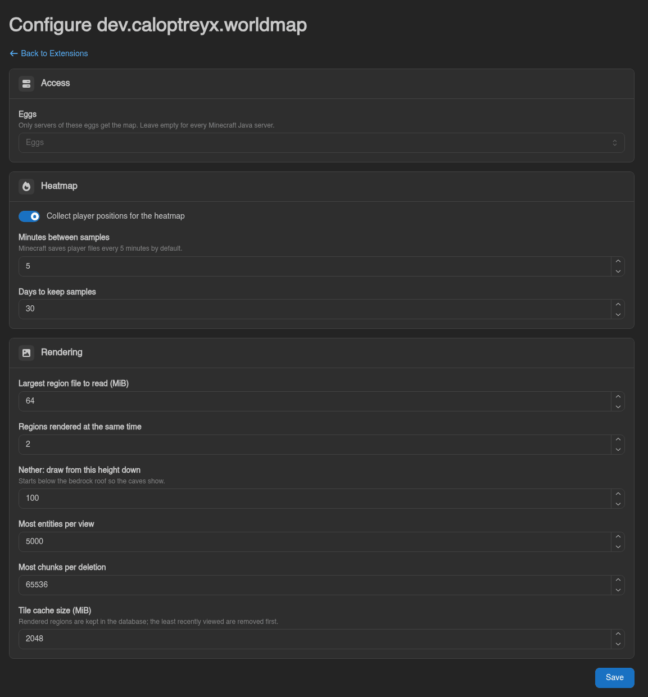

# World Map

A [Calagopus Panel](https://calagopus.com) extension that adds a **World Map** page to Minecraft
Java servers: a top-down map and a blocky 3D relief of the world, drawn from the server's own
files, with players, mobs and entities, a player heatmap, teleports, and MCA Selector's chunk tools
(filters, overlays, chunk editing, import/export) with backups.

Package name: `dev.caloptreyx.worldmap` · Requires panel `>=1.2.10`

## Features

- **2D map** of every world and dimension, block colours tinted by biome (grass, foliage, water)
  and shaded by slope, like a vanilla map item. Pan by dragging, zoom with the wheel, a pinch or a
  double-click, fullscreen. The map fills the screen below the page header.
- **3D view** (`2D | 3D` switch, remembered per server): the terrain as stepped block columns,
  each block top at its real height with walls down to lower neighbours, in the map's biome
  colours lit by the browser, with translucent water and a sky and fog per dimension (the Nether
  below its roof). Map and Fly camera modes, compass, reset, keyboard, mouse and touch controls,
  click a block for its name, biome and coordinates. See [3D view](#3d-view).
- **World Overview** panel: world select (every world found, the main one marked "(main)"),
  dimension switch, spawn coordinates and the version that last saved the selected world, the
  number of region files, jump to coordinates, and the world folder settings (gear button).
- **Player Selection** panel: every player who has joined (skin head, name, online or offline),
  their last saved position, locate on the map, and for operators teleport to another player or
  to a spot picked on the map. Player markers show their name on hover or selection; online
  players have a green dot, offline players are greyed out.
- **Layers** (toolbar): online players, offline players, spawn marker, player heatmap, mobs
  (spawn egg icons, grouped into one marker with a count per area, finer as you zoom in) and
  other entities (vehicles, items, armor stands...). The help button opens a legend.
- **Heatmap** of where players spend their time, from position samples kept for a configurable
  number of days.
- **Chunk tools** after MCA Selector: select chunks or regions, filter chunks with its queries,
  colour them with overlays, change their NBT fields, delete, copy and import them with offsets,
  download them as a zip, with a backup and one-click restore of every change (see below).
- **Cursor** readout with the block, chunk and region under the mouse; right-click to copy
  coordinates or teleport the selected player there.
- **Phones and tablets** (map narrower than 900 px): the panels open as bottom sheets from two
  buttons, the layers fold into one menu, every control is at least 40 px. Tap the map for the
  position readout and its actions, pinch to zoom, and in chunk selection tap chunks to toggle
  them or press and hold, then drag, to add a rectangle.

## Screenshots

**World Map page**: the overworld drawn from the region files, with the World Overview and Player
Selection panels.

**Mobs and entities**: grouped markers with a count per area once you zoom in.

**3D view**: the same world as stepped block columns, turned and tilted in Map mode, with the
compass, `Map | Fly`, Reset and the key hints.

**Click a block**: its block, biome and coordinates, with copy (and teleport for operators).

**Admin settings**: eggs, heatmap sampling and rendering limits.

## How the data is read

No plugin or mod is needed. The backend reads the world through the panel's file access (Wings),
exactly like the file manager:

- **Worlds**: `server.properties`, `bukkit.yml` and the folders with a `level.dat`; see
  [Worlds and dimensions](#worlds-and-dimensions).
- **Terrain**: each region file (`r.<x>.<z>.mca`, 32 × 32 chunks) is read once and rendered on the
  panel into a 512 × 512 PNG (one pixel per block). The tile is stored in the panel database and
  served again until the region file's size or modification time changes, so unchanged regions
  are never downloaded twice. Only regions on screen are rendered, at most a few at a time
  panel-wide (setting), one region file in memory per render. When more than 64 regions are on
  screen, only cached ones are shown until you zoom in.
- **3D terrain**: the same region read gives, per block column, the height of its topmost block,
  its unshaded colour (the floor's under water), and the water's depth and colour, sent as a
  compact zlib payload (`GET /surface`, about 100 to 250 KB per region) and cached in the database
  exactly like the tiles. The browser builds the block columns from it.
- The **Nether** (and datapack dimensions with a ceiling) is drawn from a configurable height
  (default 100) down, below its bedrock roof.
- **Players**: `playerdata/<uuid>.dat` (`players/data/` since 26.1) for the last saved position,
  `usercache.json` for names, the main world's player folder for everyone. Players are placed by
  Bukkit's `WorldUUID` with each world's `uid.dat`, else by their `Dimension` (Paper and Spigot
  name other worlds `minecraft:<world>`), and only drawn on the world and dimension they are in.
  Skin heads come from mc-heads.net.
- **Mobs and entities**: `entities/r.<x>.<z>.mca` (1.17+) for the regions on screen, once zoomed
  in to at most 3 × 3 regions. Icons come from mc.nerothe.com.
- **Heatmap**: a background task samples every server whose map has been opened. While a server
  runs, the game saves each online player's file every 5 minutes (and on logout); each sample
  reads the player files saved since the previous sample and counts one visit for the chunk the
  player stood in. Counts are kept per chunk and day in the database for the retention period.
- **Online players**: see [Online and offline players](#online-and-offline-players).

### Colours

`src/data/blocks.tsv` and `src/data/biomes.tsv` are generated by `scripts/gen_colors.py` from the
vanilla client jar (currently 26.3): a block's colour is the alpha-weighted average of the
texture its model shows from above; grayscale textures the game tints are marked and get the
biome's grass, foliage, dry foliage or water colour, which come from the biome definitions and the
colormaps as the client computes them. Only the derived colours are committed, no textures.
Blocks of other namespaces borrow the colour of the vanilla block their name ends with
(`mymod:redwood_planks` as planks), else gray. Regenerate with
`python3 scripts/gen_colors.py [version]`.

## Worlds and dimensions

Where the map looks, every 30 seconds at most per server (a few dozen folder listings, a few at a
time):

1. **The main world** is `level-name` from `server.properties`, read the way Java reads properties
   files (`=`, `:` or a space between key and value, `\:`, `\uXXXX` and other escapes, continued
   lines, the last of repeated keys). It may contain spaces and folders (`worlds/survival`); a
   missing file or key means `world`. With Bukkit's world container set, the main world is
   looked for in it first.
2. **Its other dimensions**: `DIM-1` and `DIM1` inside it (vanilla before 26.1),
   `<level-name>_nether`, `<level-name>_the_end` and `<level-name>_<path>` beside it (Paper and
   Spigot keep each dimension in its own world folder), and
   `dimensions/<namespace>/<path>/region` (26.1+, datapack and mod dimensions, the path up to three
   folders deep). When the same dimension exists twice (a server switched between Paper and
   vanilla), the copy whose `level.dat` was saved last wins.
3. **Bukkit's world container**: `settings.world-container` in `bukkit.yml`.
4. **Other worlds**: every folder with a `level.dat` up to two folders below the server root and
   the world container (Multiverse and similar). The map does not look into folders that cannot
   hold worlds (`plugins`, `logs`, `cache`, `libraries`, `versions`, `config`, `mods`,
   `backups`, `crash-reports`, map plugins' folders...) nor inside worlds, lists at most 64
   folders while looking and shows at most 32 found worlds.
5. **Folders added by hand**: the gear button in the World Overview (permission
   `world-map.manage-worlds`) takes up to 16 folders relative to the server root, for layouts
   the search misses (deeper folders, a `--world-container` set on the command line, a world in
   `backups/`). Absolute paths and `..` are refused; the panel's file access keeps every path
   inside the server's files anyway. Each folder shows whether a world was found in it.

Datapack and mod dimensions are labelled by their id (`namespace:path`). They are drawn like the
Overworld unless a datapack folder in the world's `datapacks/` says their dimension type has a
ceiling (`has_ceiling`, or the `minecraft:the_nether` / `minecraft:overworld_caves` types); zipped
datapacks and mods are not read, so their dimensions are drawn like the Overworld.

**Teleports** go through `execute in <dimension> run tp ...`. The main world's dimensions use their
own ids; on Paper and Spigot every other world in the container is loaded as
`minecraft:<world name in lowercase>`. Worlds the server does not load (other worlds on a vanilla
or modded server, worlds outside the container, names that are not valid keys) cannot be
teleported into: the map hides the action there.

**Everything else follows the selected world**: tiles and their cache (keyed by the region file),
entities, the heatmap (samples are kept per world folder and dimension, as in 0.1.0), chunk
deletion (only that world's region files), the spawn marker and "Go to spawn".

When there is nothing to draw the page says why: no world generated yet, or `level-name` points to
a folder that does not exist. When the main world is missing but other worlds exist, they are
shown with a note.

## Online and offline players

Each player on the map is online or offline. While the server runs, the backend asks it who is
online through the panel's Wings tunnel, without anything in the console:

1. the **query port** (`enable-query=true` in `server.properties`, port `query.port`): names
   every online player;
2. else the **Server List Ping**: names the players in its sample, which vanilla limits to 12
   and Paper can hide (`hide-online-players`). Sample entries are matched by UUID, so players
   without a cached name are found too.

A player the answer names is online; everyone else counts as offline. When the server is not
running, its state is unknown, or no source answers, every player counts as offline and the
Player Selection says so; when the ping names only some of the online players it says how many
it could not name and suggests `enable-query=true`. The answer is fetched again with the player
list every 30 seconds and when the server starts or stops. The teleport menu's "Check who is
online" can also ask the console's `list` (users who may teleport and use the console, as before).

Every position is the one in the player's file: the server saves online players every few minutes
(autosave) and when they leave, so an online player's marker can be a few minutes behind. The
extension has no live position source; reading one would mean sending a command per refresh.

**Viewer toggles**: "Online players" and "Offline players" in the toolbar (the layers menu on
phones), both on by default, filter the markers, the player select and the counts. The choice is
remembered per server in the browser with the rest of the view.

**Per-server setting**: the gear in the Player Selection header (permission
`world-map.manage-players`) turns showing online players and/or offline players off for everyone
who views this server's map. The backend leaves those players out of `GET /players`, not only the
page; with online players off, `GET /online` returns no names and the counts are left out. The
matching toolbar toggle is shown disabled with "turned off for this server". Servers default to
both, also servers that existed before 0.1.2. With online players off, an online player the
server does not name (ping sample cut off, no answer) counts as offline and is still drawn, at
their last saved position; `enable-query=true` closes that gap.

## Supported versions

| Saved by | Map |
|---|---|
| 1.18 and newer (including 26.x) | Full: blocks, biomes, entities |
| 1.13 to 1.17 | Blocks; biome tint defaults to plains; entities from 1.17 |
| before 1.13 | Not drawn: a message asks to open the world with a newer version |

Region compression: gzip, zlib (default), uncompressed and LZ4 (`region-file-compression=lz4`).
Chunks still being generated are left out of the map; chunks stored in external `.mcc` files (over
1 MiB) are not drawn, but the chunk tools read, filter, change, copy and export them.

## Permissions

The page and every endpoint check the acting user's server permissions through the panel:

| Action | Needs |
|---|---|
| View the map, players, entities, heatmap | `world-map.view` + `files.read-content` |
| Delete chunks (selection or filter matches) | `world-map.view`, `files.read-content`, `world-map.delete-chunks`, `files.create`, `files.update`, `files.delete`; server stopped |
| Change chunk fields | `world-map.view`, `files.read-content`, `world-map.edit-chunks`, `files.create`, `files.update`; server stopped |
| Copy chunks to another world, import chunks (also uploads) | `world-map.view`, `files.read-content`, `world-map.import-chunks`, `files.create`, `files.update`; server stopped (uploading a zip also `files.archive`) |
| Filters, overlays, selection files, download the selection as a zip | `world-map.view` + `files.read-content` |
| Restore an operation | the permissions of the action that made it; server stopped |
| Teleport | `world-map.view`, `world-map.teleport`, `control.console`; server running |
| Reset the heatmap | `world-map.view`, `world-map.reset-heatmap` |
| Add world folders | `world-map.view`, `files.read-content`, `world-map.manage-worlds` |
| Choose which players the map shows | `world-map.view`, `world-map.manage-players` |

Server owners and admins have all of them; give the `world-map.*` permissions to subusers like any
other permission. The console fallback for online players also needs `control.read-console`.
Every write is logged: `server:worldmap.delete-chunks`, `server:worldmap.change-chunks`,
`server:worldmap.import-chunks`, `server:worldmap.restore` (each with the chunk and file counts and
the backup folder), `server:worldmap.export-chunks`, `server:console.command` for teleports and
`list`, `server:worldmap.reset-heatmap`, `server:worldmap.update-worlds`,
`server:worldmap.update-player-visibility`.

## Admin settings

**Admin → Extensions → World Map** (`extensions.read` / `extensions.manage`):

- **Eggs**: only servers of these eggs get the map (empty: every server with a
  `server.properties` that is not Bedrock).
- **Heatmap**: on/off, minutes between samples (default 5), days to keep (default 30).
- **Rendering**: largest region file read (default 64 MiB), regions rendered at once (default 2,
  also how many regions chunk tool jobs and overlays read at once), Nether ceiling (default 100),
  most entities per view (default 5000), most chunks one chunk operation may touch (default
  65 536), tile cache size (default 2048 MiB, 2D tiles and 3D surfaces together; least recently
  viewed ones are pruned hourly).
- **Chunk backups**: days to keep the backups of chunk operations (default 7).

## 3D view

The `2D | 3D` switch at the top of the map shows the world as a blocky relief: every block column
is a block top at the height of its topmost block, with walls down to each lower neighbour (no
walls where the neighbour is as high or higher) and a skirt where a chunk is missing, so the
terrain is terraced like in the game. This is a heightmap of the surface the 2D map shows, not
a full 3D copy of the world: caves, overhangs and the undersides of trees are not drawn.

- **Look**: the 2D map's biome-tinted block colours without its slope shading; the browser lights
  them with sunlight, a different shade per side, thin block edges and darker wall bottoms.
  Water is translucent and darker the deeper it is, over its floor. The Overworld has a daylight
  sky and haze, the Nether a dark crimson fog (and is seen below its roof, from the same ceiling
  setting as the 2D map), the End a dark void.
- **Map mode** (default): drag to move, right-drag or Shift-drag to turn and tilt (15° to 85°),
  scroll to zoom toward the cursor, WASD to move (Shift faster), Q/E to turn, F for Fly mode.
- **Fly mode**: drag to look around, WASD to fly along the view, Space up, C or Alt down, Shift
  faster, Q/E to turn, scroll changes the speed, F back to Map mode.
- **Touch**: one finger moves, pinch zooms, twist turns, a two-finger drag up or down tilts.
- **Compass** (top left) shows where the camera faces; click it to face north. **Reset** goes back
  to the default angle at spawn. A hint bar at the bottom lists the keys (desktop only).
- **Click a block** (without dragging) to highlight it and see its block, biome, X/Y/Z, chunk and
  region (read from that chunk only, `GET /block`), copy its coordinates or teleport the selected
  player onto it.
- Players, spawn, mobs and entities are markers on the terrain, grouped when dense; selecting,
  locating and teleporting players, jumping to coordinates, switching worlds and dimensions,
  fullscreen and live updates work as in 2D. The heatmap and overlays tint the columns. Chunk
  selection and the chunk tools work on the 2D map; their buttons switch to it. Switching between
  2D and 3D keeps the position, world, dimension and layers.
- **Performance**: WebGL2, drawn by the extension (no 3D library). Terrain is meshed in 64 × 64
  column blocks a few per frame, merged into as few faces as possible, coarser in the distance
  (2 × 2 to 8 × 8 columns per cell), skipped outside the view, and kept in a bounded cache (about
  40 regions). Zooming out stops at a limit so memory use stays low, with a note saying so. Without
  WebGL2 the switch is disabled and the 2D map stays.

## Chunk tools

The "Chunk tools" toolbar button opens a card (a bottom sheet on phones) with the features of
[MCA Selector](https://github.com/Querz/mcaselector), using its names, its query syntax and its
selection files, so selections and queries move between the two.

- **Selection**: chunks or whole regions (the region mode switches on by itself when chunks are
  smaller than 4 px). Drag adds a rectangle, Alt-drag (or the Remove switch) removes one, a click
  toggles. Select all, invert and clear work like MCA Selector: an inverted selection means every
  chunk of the regions that exist except the unselected ones. Selections are saved and opened as
  MCA Selector CSV files (`inverted` first line, `rx;rz` for a whole region, `rx;rz;cx;cz` for a
  chunk), copied and pasted as that text, and loaded to replace, merge with or subtract from the
  current one.
- **Filter chunks**: a builder (AND/OR groups, negated groups) kept in sync with a query box in
  MCA Selector's syntax, for example `InhabitedTime < "5 minutes" AND Status != "full"`. Fields:
  `DataVersion`, `InhabitedTime`, `LastUpdate`, `Timestamp`, `xPos`, `yPos`, `zPos`, `Status`,
  `Biome`, `Palette`, `Entities`, `#Entities`, `#ProtoEntities`, `#TileEntities`, `Structures`,
  `LightPopulated`, `Compression`, `Circle`, `Border`, and World Map's `Size` (compressed chunk
  size). `PlayerLocation`, `PlayerSpawn`, `Selection`, `Custom` and `Script` are not available.
  A filter runs as a background job over every region file of the dimension (or only the
  selection), one region at a time, with progress and cancel; it then shows how many chunks match
  and offers to select them, add them to the selection or delete them. As in MCA Selector, chunk
  positions without a chunk can match (`InhabitedTime < 10`, `Circle`); selecting them is harmless.
- **Overlays** (layers menu): `InhabitedTime`, `LastUpdate`, `Timestamp`, `DataVersion`,
  `#Entities`, `#TileEntities`, `AverageHeight`, `#Blocks` (with block names) and `Size`, coloured
  per chunk from a min/max (empty: the range of what is shown) with a legend. Values are computed
  per region and cached in the database while the region (and entities) file keeps its size and
  time, like the tiles.
- **Change fields** of the selected chunks (MCA Selector's "Change fields" with its syntax, for
  example `InhabitedTime = 0, Status = "minecraft:full"`): `Status`, `FixStatus`,
  `InhabitedTime`, `LastUpdate`, `Timestamp`, `DataVersion`, `Compression`, `Biome`,
  `ReplaceBlocks`, `DeleteEntities`, `DeleteSections`, `FixHeightmaps`,
  `DeleteStructureReference`, `PreventRetrogen`, `ForceBlend`, `RemoveLightingInfo`,
  `LightPopulated`, and "Force" to set fields a chunk does not have. Unlike MCA Selector 2.9,
  `DeleteEntities` also empties the `entities/` files of 1.17+ worlds.
- **Copy and import** (MCA Selector's "Import chunks"): copy the selected chunks to another world or
  dimension of the server, or import from one, with an offset in chunks (x, z) and sections (y),
  overwrite or keep existing chunks, section ranges (`-4:3,10`), and optionally only into the
  selected chunks. Coordinates inside the chunks move with them (chunk position, sections, block
  entities, ticks, structures, entities with new UUIDs, points of interest). A world from
  elsewhere: upload `.mca` files or a zip (with `region/`, `entities/`, `poi/` folders, also inside
  a world folder) through the panel's upload; it is staged in `.worldmap-imports/` and removed after
  the import. **Download as zip** streams the selected chunks as a zip of region files (the
  `region/`, `entities/` and `poi/` folders of a world).
- **History**: every write (deleting, changing, importing, restoring) is an operation with its
  backup; the latest one is restored in one click.

### Safe writes

- Chunk operations only run while the server is **stopped**, and check that again (uncached)
  before every file they write; a server that starts stops the operation.
- **Backup first**: before a file is changed, the original is moved (renamed, no copy) into
  `.worldmap-backups/<YYYYMMDD-HHMMSS>-<kind>-<id>/<its path>`, with a `worldmap-operation.json`
  manifest. The panel's backups are not used: they archive the whole server, take long, count
  against the backup limit and restore all or nothing.
- **Atomic per file**: the new file is written next to the original as `.<name>.worldmap-tmp` and
  renamed into place once complete, so a crash never leaves a half-written region file (at worst a
  file is missing and its backup is there). Wings' own writes overwrite in place, so this is done
  with its rename.
- `region/`, `entities/` and `poi/` files are changed together, as MCA Selector does. Unchanged
  chunks keep their bytes, compression and timestamp; region headers are written fresh and
  compact. Chunks over 1 MiB go to `c.<x>.<z>.mcc` files as the game does.
- **Restore** moves the backups back and sets the files the operation wrote aside in
  `<backup>/replaced/`. Only operations no newer operation touched the same files of can be
  restored. Backups are deleted after the retention setting (default 7 days), upload staging
  folders after a day.
- Jobs run in the panel's memory: one write job per server at a time, regions read one at a time
  within the panel-wide "regions rendered at once" limit. Restarting the panel stops running jobs;
  what they wrote so far stays restorable from the history.

## Limits

- The map shows the world as last saved: the server writes chunks and player files on its own
  schedule (autosave, every 5 minutes by default), so very recent changes appear later. Online
  players are drawn where they were last saved too.
- The sidebar entry shows on every server the user may view (the panel's route filter cannot see
  the server). Non-Minecraft servers get an explanation instead of the map; hide the entry for
  other eggs with the panel's egg configuration (sidebar routes) or limit the extension to some
  eggs in its settings.
- The heatmap starts collecting the first time a server's map is opened, and only while the
  server runs.
- Teleporting to a map position puts the player on the topmost block there (or the floor under
  the Nether ceiling); the chunk must have been generated, and the server must load the world.
- Very large worlds: tiles render on first view (about a second per region); zoomed far out only
  already-rendered regions are shown.

## API

Below `/api/client/servers/{server}/world-map`: `GET /` (worlds, spawn, capabilities, player
setting), `GET /regions`, `GET /tile` (PNG), `GET /surface` (3D: zlib payload of column heights,
colours and water, format in `src/surface.rs`), `GET /block` (one block column, JSON),
`GET /players` (positions, who is online),
`GET /online` (names, for teleports), `GET /entities`, `GET|DELETE /heatmap`,
`POST /teleport`, `PUT /worlds` (folders added by hand), `PUT /players/visibility`
(`{"online": bool, "offline": bool}`). Chunk tools: `POST /filter/check`, `POST /changes/check`,
`GET|POST /jobs` (`kind`: `filter`, `delete`, `change`, `import`), `GET /jobs/{id}`,
`POST /jobs/{id}/cancel`, `GET /overlay`, `POST /export` (zip), `POST /imports`,
`POST /imports/extract`, `GET /operations`, `POST /operations/{id}/restore`. Selections travel as
`{"inverted": bool, "regions": [{"x", "z", "chunks": null | base64 of a 1024-bit set}]}`. Admin:
`GET|PUT /api/admin/extensions/dev.caloptreyx.worldmap/settings`.

## Development

Crate at the repository root, frontend in `frontend/`, migrations in `migrations/`. CI
(`.github/workflows/check.yml`) builds the extension inside the newest panel release: typecheck,
oxlint/oxfmt, `pnpm build`, the node tests in `tests/` and `cargo test`. The Rust tests compare
chunk parsing against `tests/fixtures/` (chunks cut from real Paper 1.21.4 and 26.3 worlds, every
region compression, synthesized 1.13/1.16 and pre-1.13 chunks, with expected surfaces computed by the
independent reader in `scripts/make_fixtures.py`), and cover colour lookup, world and dimension
detection, chunk/region math, region rewriting and the permission gating of chunk deletion and
teleports.

Install by hand: `python3 scripts/package.py` builds `dist/dev_caloptreyx_worldmap.c7s.zip`.
Releases: tag `vX.Y.Z` and publish a GitHub release; `release.yml` attaches
`dev_caloptreyx_worldmap.c7s.zip`. Keep `Cargo.toml`'s version in sync with the tag.

## License

MIT
